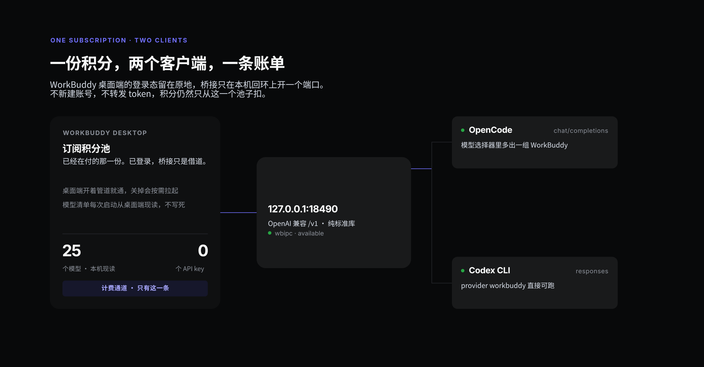

# WorkBuddy Bridge

[](https://github.com/Huichao007/workbuddy-bridge/actions/workflows/ci.yml)
[](https://github.com/Huichao007/workbuddy-bridge/releases)
[](LICENSE)


**装完之后，你的 OpenCode 和 Codex CLI 就能直接用 WorkBuddy 的模型和积分 —— 不需要 API key。**

一条命令装好，两个客户端同时可用。国内版、国际版的积分还能**同时**接入，各走各的端口。

> **先看这张图就懂了** → [介绍页](https://huichao007.github.io/workbuddy-bridge/)（一份积分怎么同时喂两个客户端）



---

## 装上就有的东西

| 你会得到                                | 怎么用                                                          |
| --------------------------------------- | --------------------------------------------------------------- |
| **OpenCode 里多一组模型**               | 模型选择器出现 `WorkBuddy 国内版` 分组，22 个模型带积分倍率     |
| **Codex CLI 能跑 `workbuddy` provider** | `codex -c model_provider=workbuddy -c model=... exec "..."`     |
| **原有配置不被动**                      | 只往你的配置里**加** provider，其它 provider 和默认模型原样保留 |
| **掉线自愈**                            | 登录自启 + 每 10 分钟保活，桌面端掉了会按需拉起                 |

装完之后，下面这两条命令**立刻就能跑**（这是本项目实测输出，不是示意）：

```powershell
PS> opencode run -m workbuddy/deepseek-v4.1-flash "回答：OpenCode 已连通，只输出这一句"
> build · deepseek-v4.1-flash
OpenCode 已连通

PS> codex -c model_provider=workbuddy -c model=deepseek-v4.1-flash exec "回答：Codex 已连通，只输出这一句"
codex
Codex 已连通。
tokens used
14,891
```

```
OpenCode  ─┐                        ┌─► bridge(cn)   127.0.0.1:18490 ─┐
Codex CLI ─┼─► 同一个 /v1 协议 ─────┤                                  ├─► 各版本桌面端登录态
Cursor    ─┘                        └─► bridge(intl) 127.0.0.1:18491 ─┘      （扣对应积分）
```

不需要 API key，不需要第三方中转，不上传任何 token —— 请求走你自己电脑上 WorkBuddy 桌面端
已经建立的命名管道。

---

## 快速开始（3 条命令）

前提：Windows 10/11、装了 Python 3.9+、WorkBuddy 桌面端**已登录**。

```powershell
git clone https://github.com/Huichao007/workbuddy-bridge.git D:\tools\workbuddy-bridge
cd D:\tools\workbuddy-bridge
python setup.py
```

`setup.py` 一次做完五件事，全程有回显：

1. 找到本机所有 WorkBuddy 安装；
2. 逐个**真开一次命名管道**，排除掉没登录 / 已卸载留下的旧配置；
3. 给每个活着的积分池分配一个端口，写进 `instances.json`；
4. 拉起桥接，等 `/health` 真的返回 ok 才继续；
5. 把 provider 块合并进你的 `opencode.json` 和 `config.toml`（先备份，只动自己那几行），
   并注册「登录自启 + 每 10 分钟保活」两个计划任务。

跑完会打印一张表，形如：

```
  cn     workbuddy      http://127.0.0.1:18490/v1   22 models   [started]
  intl   workbuddy-intl http://127.0.0.1:18491/v1   18 models   [started]
```

## 30 秒验证它真的通了

```powershell
python doctor.py                       # 接线自检，最后一行 ALL GOOD 就是全通
python smoke.py                        # 真发一次请求，两种协议都验
```

`doctor.py` 回答的是「线接好了吗」，`smoke.py` 回答的是另一件更直接的事：
**「现在能拿到回答吗」**。它会自动挑一个倍率最低的模型，分别打
`/v1/chat/completions`（OpenCode 用）和 `/v1/responses`（Codex 用），
打印耗时和 token 数。实测输出：

```
  [ok] default chat/hy4free  2.1s, 'OK', 86 tokens
  [ok] default responses/hy4free  2.4s, 'OK'

SMOKE OK - both protocols answered with a real model call
```

想用真实客户端再确认一次，挑一个你已经有的模型 id（**别照抄下面的 id，WorkBuddy 会换**）：

```powershell
curl.exe http://127.0.0.1:18490/v1/models       # 你现在有哪些模型

# OpenCode
opencode run -m workbuddy/<model-id> "说三个字"

# Codex
$env:WORKBUDDY_API_KEY = "wb-bridge-local"      # 占位，桥接不校验
codex -c model_provider=workbuddy -c model=<model-id> exec "说三个字"
```

两个都能回话，就是装好了。

其他常用命令：

| 命令                                  | 作用                                  |
| ------------------------------------- | ------------------------------------- |
| `python setup.py status`              | 看每个实例现在活没活、几个模型        |
| `python setup.py stop`                | 停掉 `setup.py` 拉起的桥接            |
| `python setup.py uninstall`           | 停服务 + 删自启任务（客户端配置保留） |
| `python setup.py --dry-run`           | 只探测、不启动、不写配置              |
| `python setup.py --ports 18500,18501` | 端口被占时手动指定                    |
| `python setup.py --clients none`      | 只起桥接，不碰客户端配置              |

> 重跑 `setup.py` 是安全的：它不会重复加端口，也不会把你正在用的配置改到别的端口上。

---

## 国内版 + 国际版同时用

两个版本是**两个独立安装、各自一套登录态和积分**。桥接一个进程只服务一个积分池，
所以「同时用」= 两个进程、两个端口，`setup.py` 会自动发现并安排：

| 你装了什么         | 结果                                                        |
| ------------------ | ----------------------------------------------------------- |
| 只有国内版         | 一个实例，端口 18490，provider `workbuddy`                  |
| 只有国际版         | 一个实例，端口 18490，provider `workbuddy-intl`             |
| 两个都装了并都登录 | 端口 18490 / 18491，provider `workbuddy` / `workbuddy-intl` |
| 装了但有一个没登录 | 只接入登录的那个，另一个明确告诉你「不可达，跳过」          |

判定依据不是猜目录名：`setup.py` 读每个版本自己的
`cache/acc-product-config-v3.json` 里的 `endpoint`（国内是 `https://www.workbuddy.cn`），
再用命名管道真连一次。日志里会写清楚每个实例用的是哪个目录、哪个上游。

模型选择器里会分成两个组：

```
WorkBuddy 国内版 (China)      → 22 个模型，倍率后缀如 GLM-5.3 (0.69x)
WorkBuddy International (国际版) → 该订阅自己的模型清单
```

某个版本不上某个模型，就是那个版本真的没有 —— 清单每次启动从桌面端产品配置现读，不写死。

---

## 它到底怎么工作

三层，全部在本机：

1. **WBIPC 命名管道**。WorkBuddy 桌面端自带一个 Python 客户端 `workbuddy_ipc`
   （随安装包分发，WorkBuddy 自己的 skills 也用它）。桥接运行时把它加进 `sys.path`，
   **import 你安装目录里的那一份**，所以永远和当前桌面端版本匹配；仓库里不分发这段代码。
2. **`bridge.py`**。纯标准库的 HTTP 服务，把 OpenAI 协议翻译成管道调用。
   模型清单从桌面端产品配置读取，和你在客户端看到的选单一模一样。
3. **协议适配**。`/v1/chat/completions` 给 OpenCode / Cursor / 任意 SDK；
   `/v1/responses` 给 Codex CLI（它已经不再支持 `wire_api = "chat"`）。

细节见 [`docs/ARCHITECTURE.md`](docs/ARCHITECTURE.md)。

## 特性

- **零密钥**：客户端填任意占位 key，鉴权由桌面端登录态承担。
- **多实例**：国内版 / 国际版同时接入，端口、日志、失败快照全部分开。
- **模型清单自动跟随**：桌面端改价、上下架模型，重启桥接就同步。
- **两种协议**：Chat Completions + Responses API（Codex 必需）。
- **工具调用**：流式分片会正确聚合成 `tool_calls`，OpenCode / Cursor 的 Agent 模式可用。
- **图片输入**：模型支持时透传。
- **推理档位自动补齐**：缺 `reasoning_effort` 会 400 的模型，桥接按产品配置注入。
- **桌面端掉了会自愈**：管道不可达时按需拉起桌面端并等待重连（带冷却）。
- **失败快照**：`WB_BRIDGE_DUMP=err` 只记录失败请求。
- **纯标准库**：`pip install` 一个包都不用。

## 系统要求

| 项               | 要求                                                           |
| ---------------- | -------------------------------------------------------------- |
| 操作系统         | Windows 10/11（WBIPC 是 Windows 命名管道，macOS/Linux 不适用） |
| WorkBuddy 桌面端 | 已安装并**已登录**（积分来自这个登录态）                       |
| Python           | 3.9+，`python` 在 PATH 里                                      |
| 端口             | 默认 18490 起，每个实例占一个                                  |

## 接入客户端

`setup.py` 已经替你写好配置。下面是它写了什么，以及怎么手动改。

### OpenCode

`setup.py` 会往你的 `opencode.json` 的 `providers` 里合并条目（v2 用 `package` + `settings`）：

```json
{
  "providers": {
    "workbuddy": {
      "name": "WorkBuddy 国内版 (China)",
      "package": "@opencode/ai/providers/openai-compatible",
      "settings": { "baseURL": "http://127.0.0.1:18490/v1" },
      "models": { "...": "从桥接 /v1/models 现读" }
    }
  }
}
```

只改自己那几个 provider，其它键和别的 provider 原样保留；写前自动备份成
`opencode.json.bak-setup-<时间戳>`。

模型变了想单独同步（不跑整套 setup）：

```powershell
python tools\sync-opencode.py --provider workbuddy --port 18490 --apply
```

### Codex CLI

`setup.py` 往 `%CODEX_HOME%\config.toml`（默认 `~\.codex\config.toml`）追加：

```toml
[model_providers.workbuddy]
name = "WorkBuddy 国内版 (China)"
base_url = "http://127.0.0.1:18490/v1"
wire_api = "responses"
env_key = "WORKBUDDY_API_KEY"
```

然后：

```powershell
$env:WORKBUDDY_API_KEY = "wb-bridge-local"      # 占位，桥接不校验
codex -c model_provider=workbuddy -c model=deepseek-v4.1-flash exec "写个快排"
```

关键点只有一条：`wire_api = "responses"`。如果你的 Codex 版本已经不需要占位 key，
可以用 `requires_openai_auth = false` 代替 `env_key` 那一行，两种写法桥接都接受。

### Cursor

Cursor 的 BYOK 和自定义 Base URL 藏在它的 SQLite 设置库里，界面不让填本地地址。
脚本改，会先关 Cursor、全量备份、写完校验，失败自动回滚：

```powershell
python clients\cursor-point-to-bridge.py --port 18490
python clients\cursor-point-to-bridge.py --restore     # 撤销
```

### 任意 OpenAI SDK / curl

```python
from openai import OpenAI
client = OpenAI(base_url="http://127.0.0.1:18490/v1", api_key="local")
print(client.chat.completions.create(
    model="deepseek-v4.1-flash",
    messages=[{"role": "user", "content": "你好"}],
).choices[0].message.content)
```

`GET /v1/models` 只有一个用途：看你现在**到底有哪些模型**。别照抄文档里的 id，WorkBuddy 会换。

## 日常运维

| 想做的事           | 命令                                                             |
| ------------------ | ---------------------------------------------------------------- |
| 全量自检           | `python doctor.py`                                               |
| 看状态             | `python setup.py status`                                         |
| 前台跑（看日志）   | `python bridge.py --instance cn`                                 |
| 手动起全部         | `scripts\start-bridge.ps1`                                       |
| 注册/删除自启      | `scripts\install-task.ps1` / `... -Remove`                       |
| 同步 OpenCode 模型 | `python tools\sync-opencode.py --apply`                          |
| 看失败快照         | 设 `WB_BRIDGE_DUMP=err`，落在 `dumps-<port>/`（只留最近 300 个） |
| 换端口             | `python setup.py --ports 18500`                                  |

环境变量：

| 变量                   | 默认      | 说明                                                                                           |
| ---------------------- | --------- | ---------------------------------------------------------------------------------------------- |
| `WORKBUDDY_HOME`       | 自动探测  | 含 `WorkBuddy.exe` 的目录                                                                      |
| `WORKBUDDY_CONFIG_DIR` | 自动探测  | 桌面端配置目录（`wbipc\endpoint.json` 所在）。**显式设置后即为唯一来源**，这是双版本隔离的关键 |
| `WB_BRIDGE_PORT`       | 18490     | 监听端口                                                                                       |
| `WB_BRIDGE_HOST`       | 127.0.0.1 | 监听地址，**别改成 0.0.0.0**                                                                   |
| `WB_BRIDGE_LABEL`      | WorkBuddy | 日志和 `/health` 里显示的名字                                                                  |
| `WB_BRIDGE_DUMP`       | 空        | 空=不落盘；`err`=只存失败；`full`=全存                                                         |

## 已知限制

这些是设计边界，不是 bug：

1. **缓冲式转发，没有逐字流式。** WBIPC 没有流式原语，上游整段收完才回给客户端。
   首字延迟 ≈ 整段生成时间，长回答会「卡一下然后一次吐完」。
2. **单次响应有体积上限。** 桌面端 `http.fetch` 对响应体有硬编码上限（约 640 KB），
   超出会 `E_PAYLOAD_TOO_LARGE`。仓库**不提供**修改 WorkBuddy 安装包绕过上限的方案。
3. **桌面端必须开着且登录。** 桥接是「借用」不是「替代」。
4. **仅供 Windows。** 依赖 Windows 命名管道。
5. **积分归属不变。** 消耗都记在你 WorkBuddy 账户上，只走一条计费通道。

## 故障排查

| 现象                                                | 原因                       | 处理                                          |
| --------------------------------------------------- | -------------------------- | --------------------------------------------- |
| `FATAL: WBIPC client library not found`             | 安装目录没探测到           | 设 `WORKBUDDY_HOME=...\WorkBuddy`             |
| setup 说某会话 `NOT reachable`                      | 那个版本没开 / 没登录      | 开桌面端并登录，重跑 `python setup.py`        |
| `/health` 里 `wbipc.available=false`                | 同上                       | 同上                                          |
| 503 `WorkBuddy 桌面端未运行`                        | 同上                       | 手动开一次桌面端                              |
| 400 `missing model`                                 | 模型 id 过期               | `GET /v1/models` 重新取                       |
| 400 提到 `reasoning_effort`                         | 该模型必须显式给档位       | 桥接已自动补齐；仍失败就重启桌面端            |
| Codex 报 `wire_api = "chat" is no longer supported` | 配置没换                   | 改成 `responses`                              |
| Codex 报 `Not inside a trusted directory`           | Codex 自身的安全限制       | 加 `--skip-git-repo-check`，或在 git 仓库里跑 |
| setup 说端口被占                                    | 上一次没退干净             | `python setup.py stop` 或 `--ports` 换端口    |
| setup 说「已有 autostart 任务」                     | 机器上还有别的工作桥接任务 | 先删旧任务再重跑，避免抢端口                  |

更多见 [`docs/TROUBLESHOOTING.md`](docs/TROUBLESHOOTING.md)。

## 安全、合规与免责

**这一段请认真读完，再决定要不要用。**

- **本机回环**。默认只监听 `127.0.0.1`，局域网内其它机器访问不到。请保持默认。
- **不碰凭证**。桥接不读取、不存储、不转发你的账号密码或 token；鉴权在桌面端进程里完成。
  仓库里不含任何密钥，`relay-models.json` / `instances.json` 都在 `.gitignore` 中。
- **只读你的桌面端**。安装脚本只写 `instances.json`、客户端配置和两个计划任务，
  不改 WorkBuddy 安装目录、不动它进程。
- **合规风险由使用者承担**。本项目通过非官方入口（桌面端自带的 WBIPC 客户端）复用订阅额度。
  WorkBuddy 的用户协议可能不认可「用第三方客户端消耗订阅积分」，厂商也可能随时改协议、改管道、
  封禁账号。**这就是一个个人自用的便利工具，不承诺长期可用，不承诺不违反服务条款。**
  商用、对外提供服务、代他人调用——风险更高，请自行评估。
- **不提供绕过厂商保护的功能**。仓库里没有修改安装包、重算完整性哈希、绕过签名校验的脚本。
- **本项目与 WorkBuddy 官方无关**，未获其认可或授权。名称仅用于说明兼容对象。

## 项目结构

```
workbuddy-bridge/
├─ setup.py                      # 一键部署：发现 → 起服务 → 写客户端配置 → 装自启
├─ doctor.py                     # 自检，先跑这个
├─ smoke.py                      # 真发一次请求，两种协议都验（会消耗少量积分）
├─ bridge.py                     # 核心：OpenAI 兼容 HTTP 服务 + WBIPC 上行
├─ translate.py                  # SSE 聚合 / 工具调用合并（纯函数，可单测）
├─ instance.py                   # --instance / --port / --config-dir 解析
├─ responses_api.py              # Responses ⇄ Chat Completions（Codex 用）
├─ wbpaths.py                    # 安装目录 / 配置目录探测（支持多安装）
├─ scripts/
│  ├─ start-bridge.ps1           # 幂等启动器（按 instances.json 起全部）
│  ├─ watchdog.cmd               # 给「启动文件夹」用的壳
│  └─ install-task.ps1           # 注册登录自启 + 10 分钟保活（-Remove 删除）
├─ tools/
│  └─ sync-opencode.py           # 把模型清单写回 opencode.json
├─ clients/
│  ├─ opencode.json              # provider 片段
│  ├─ codex.config.toml          # provider 片段（wire_api=responses）
│  └─ cursor-point-to-bridge.py  # 改 Cursor 设置库（带备份/回滚）
├─ tests/                        # 协议逻辑单测（CI 里跑，不需要装 WorkBuddy）
├─ docs/
│  ├─ ARCHITECTURE.md
│  ├─ CLIENTS.md
│  ├─ TROUBLESHOOTING.md
│  └─ LIMITATIONS.md
└─ relay-models.example.json     # 可选：接入第二家中转
```

运行时才会出现的文件（都在 `.gitignore` 里）：`instances.json`（本机实例表）、
`run/`（进程号与启动日志）、`bridge*.log`、`dumps-*/`。

## 设计取舍

- **import 而不是 vendoring**。`workbuddy_ipc` 属于 WorkBuddy 的安装内容，
  复制进仓库既侵权也会版本错配。
- **模型清单只有一个来源**。不维护静态表，每次启动读桌面端产品配置。
- **缓冲而不是假装流式**。管道没有流式原语，硬做「逐字吐」只会把延迟藏起来。
- **一个进程一个积分池**。不做「一个端口多账号调度」——那会让人分不清钱从哪扣。
- **显式配置目录优先于任何自动探测**。双版本场景下，自动挑「最新的那个」正是会串账号的写法。
- **失败快照有上限**。`dumps-*/` 只留最近 300 个，避免长跑把磁盘写满。

## License

MIT，见 [LICENSE](LICENSE)。

---

**English**: see [README.en.md](README.en.md).
